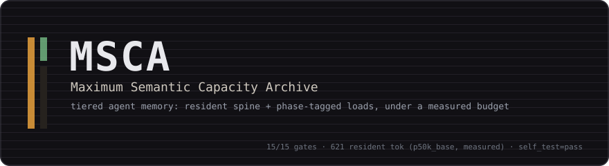
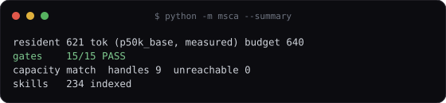

# MSCA — Maximum Semantic Capacity Archive

<p align="center"></p>

> Verified on the reference machine (2026-11-05) — all commands below were
> executed today, and their outputs are reproduced in the cards and quick
> start: `python -m msca.gates` → **ALL GATES PASS (15/15 gates,
> self_test=pass)**; `python -m msca --summary` → **resident 621 tok
> (p50k_base, measured) budget 640 · capacity match, 9 handles, 0 unreachable ·
> skills 234 indexed**; `python -m msca.capacity --verify` → **capacity record:
> MATCHES code**; `python -m msca.loader --coverage` → **UNREACHABLE: none**;
> `python -m msca.loader --phase N [--tag T]` loads cleanly (exit 0).

<p align="center"></p>

**MSCA** is a tiered agent-memory archive for software agents that use
language models. Instead of one long context window, it keeps a tiny,
always-present spine of rules (Tier 1) and loads every other piece of
knowledge on demand (Tier 2/3), under an explicit, measured budget.

- **Tier 1 (resident):** **621 tokens, measured with a real tokenizer**
  (`p50k_base` — `msca/tokens.py` measures because chars/4 is an estimate and
  the estimate was wrong), under a hard 640-token budget
  (`MSCA_R1_MAX_TOKENS`). Generated from a single source file
  (`msca/spine.py`) so the rules and their documentation cannot drift. The
  measurement record lives in `msca_store/capacity.json` and is re-checked
  against the live code on every gate run (R3).
- **Tier 2 (phase-driven, tag-routed):** loaded at every phase transition —
  `python -m msca.loader --phase N [--tag T]`. A non-zero exit or an empty
  result is a FAIL: never continue from a partial load. The loader refuses
  unknown keys, and `--coverage` proves no section is unreachable.
- **Tier 3 (answering):** legitimately answering from loaded tiers is valid;
  *implying* it came from Tier 1 is not. Tier identification is first-class,
  and the honesty invariants bind regardless of task, cost, or pressure.

## What the gates measure

`python -m msca.gates` runs **15 executable gates** — the dev policy as
executable code — and exits non-zero on any failure, so it can be a CI step
and not a checklist. Row-by-row, measured today:

| Gate | Measured 2026-11-05 | Floor |
|---|---|---|
| `R1` resident ceiling | 621 tok (measured, `p50k_base`) | ≤ 640 (`MSCA_R1_MAX_TOKENS`) |
| `R6` no self-certification | 0 hits | 0 hits |
| `R7` redundancy | 0.0 % | ≤ 5 % |
| `R7` decoration | 0.00 % | ≤ 0.50 % |
| `PTR` targets resolve | 7 ptrs, 0 dead | 0 dead |
| index covers all sections | 0 unreachable | 0 unreachable |
| index complete 1–15 | 0 missing | 0 missing |
| sections non-trivial | 0 stub | 0 stub |
| `R4` loud-fail | raises + probes | must raise |
| `R3` capacity record | matches code | no drift |
| `R5` store round-trip | 9 handles, 0 mismatch | 0 mismatch |
| `R5` handle grammar | unknown/malformed/empty | all raise |
| `R12` ontology algebra | EQL transitive, INS non-transitive | 0 violations |
| `R9` docs no-drift | addendum == spine | regenerate: `python -m msca --regen-docs` |
| `D5` capacity floor | 181.243 bits/tok (+31.243 vs 150.0) | ≥ 150.0 bits/tok |

**The self-test is the meta-gate (G-OPS):** a gate that has never been run
against a failing input is a claim, not a check. `self_test()` injects three
deliberate defects — an R1 budget overflow, a false R6 self-certification, an
R7 decoration pad — plus a D5 metric regression, asserts the gates go RED on
each, then restores the tier. Today's run read `['F','P','F','P']`, `['P',
'F','P','P']`, `['F','P','P','F']`, and `F` respectively: the suite
demonstrably detects corruption *and* metric regression. A suite that stays
green under deliberate breakage is worse than no suite.

The ten **dev-policy** names — `EXTENSIBLE, MODULAR, SCRIPTABLE,
INTEROPERABLE, PROGRAMMABLE, SCALABLE, REPLICABLE, TESTABLE, VALIDATABLE,
OPERABLE` — are spelled out with their definitions in the resident spine
(`msca/spine.py`, loaded via `--phase 12`; e.g. `REPLICABLE` = "run twice,
diff == 0", `OPERABLE` = "100% of declared features actually executed, not
merely listed") and the gate suite above is their executable form.

## Quick start

All verified on 2026-11-05 (repository root, no network needed):

```bash
python -m msca --summary            # tier-1 budget, gate verdict, store health
python -m msca.gates                # 15 gates + corruption self-test (CI-able)
python -m msca.capacity --verify    # R3: record vs live code
python -m msca.loader --phase 1     # loads the honesty invariants + routing
python -m msca.loader --coverage    # proves every section is reachable
```

Verbatim expected outputs:

```text
$ python -m msca --summary
resident 621 tok (p50k_base, measured) budget 640
gates    15/15 PASS
capacity match  handles 9  unreachable 0
skills   234 indexed

$ python -m msca.gates            # (15 PASS rows, then the self-test block)
self_test: gates demonstrably detect corruption AND metric regression

ALL GATES PASS  (15/15 gates, self_test=pass)

$ python -m msca.capacity --verify
capacity record: MATCHES code
  recorded_at=2026-11-04T20:05:47+0200 commit=e699268

$ python -m msca.loader --coverage
sections   : 9
via phase  : 6
via tag    : 9
UNREACHABLE: none
```

`--phase 1` prints the honesty invariants, the decision-routing rules
(Q0 lookup → Q5 explicit-revision chain, with the rate budget), the MSCA
ontology grammar (TRANSPORT / CONTROL / RELATIONS / MERONYMY / EPISTEMIC /
INVARIANTS), and the verbatim DISCLOSURE BLOCK template. The full gate
output, verbatim, is committed as `assets/terminal_gates.svg`.

## Repository layout (complete tracked tree)

| Path | Role |
|---|---|
| `msca/spine.py` | Tier-1 resident spine — single source of truth for the always-on rules; regenerates the agent file (`--regen-agent`) and the docs addendum (`--regen-docs`) |
| `msca/gates.py` | 15 executable gates + corruption self-test (`python -m msca.gates`) |
| `msca/loader.py` | Phase/tag loader; refuses unknown keys; `--coverage` self-check |
| `msca/capacity.py` | R3 verification of the capacity record against live code (`capacity --verify`) |
| `msca/tokens.py` | Real-tokenizer measurement for the R1 resident ceiling (`p50k_base`) |
| `msca/store.py` | Durable handle binding (`store --mint`) over `msca_store/` |
| `msca/relate.py` | EQL/ISA/INS relation-algebra engine (checked by `R12`) |
| `msca/findings.py` | Measured-defect ledger |
| `msca/doctor.py` | Environment/health doctor |
| `msca/context.py`, `msca/memory_cap.py` | Context-window accounting and cap enforcement |
| `msca/agent_loop.py`, `msca/coordination.py`, `msca/capability.py` | Agent loop, coordination, capability registry |
| `msca/learning.py` | Learning ledger |
| `msca/tools_seq.py` | Toolcall-sequence management for the agent stack |
| `msca/transport.py` | Transport layer integrating store, glyphs, and ECT |
| `msca/ect.py` | Error-Correction Transport (data + parity + checksum) |
| `msca/glyph.py` | Glyph/handle utilities |
| `msca/env.py` | LLM/dev-environment management |
| `msca/llm.py` | LLM plumbing |
| `msca/robot.py` | Robot coordination and calibration with glyph-based toolcall sequences |
| `msca/simulation.py` | Simulation-based calibration and calculation |
| `msca/skills_bank.py` | Deterministic index of local skills (234 indexed today) |
| `msca/__main__.py` | `python -m msca` entry point |
| `msca_store/` | Content-addressed store: 9 blobs (`G_*.blob`), `index.json`, and the `capacity.json` record that R3 verifies |
| `tools/make_doc_assets.py` | Generates `assets/` from **live** runs of the verification commands — regenerate and the cards re-verify themselves |
| `assets/` | `banner.svg`, `terminal_summary.svg`, `terminal_gates.svg` (verbatim output) |
| `MSCA_REQUIREMENTS.md` | The draft spec for a maximum-semantic-capacity agent system prompt |
| `MSCA_AGENT_MANUAL_ADDENDUM.md` | Generated manual addendum — kept identical to the spine by R9 |

## Runtime state (excluded from version control)

Machine-local runtime state (learning/memory ledgers) is gitignored under
both the pre-rename `.mcsa_*` and current `.msca_*` spellings; no such file
needs to exist for the gates to pass. `msca_store/` **is** versioned — the
capacity record and its blobs are part of what `--verify` checks.

## Relationship to the ONE paper

MSCA is the agent-memory instantiation of the O-OIS grammar in "Maximum
Semantic Capacity via the Ontology of Optimal Information Structure" (2026):
measure the budget, load on demand, and let every claim name the tier that
answered. Sibling repositories: **POINTS** (the machine-facing 8,192-byte
glyph codec) and **65536** (the human-facing symbol font and hierarchy
codec).

## License

MIT — see [`LICENSE`](LICENSE).
